# Bruchmonster

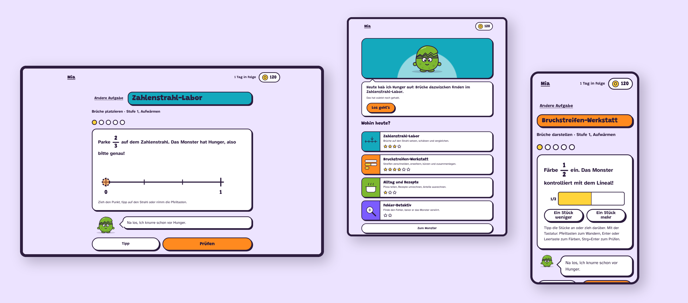

Eine Lern-App zur Bruchrechnung für die 6. Klasse (Gymnasium und Realschule). Kinder üben in vier frei wählbaren Welten, verdienen Münzen und ziehen damit ein Comic-Monster groß: füttern, einkleiden, eine Höhle einrichten, Sammelkarten finden.

Die App besteht aus **einer einzigen HTML-Datei**. Sie läuft komplett im Browser, braucht kein Internet, kein Konto und keinen Server. Es werden keine Daten übertragen, und Schriften oder Skripte kommen nicht von fremden Servern.

**Direkt im Browser ausprobieren: [tjrschmidbauer.github.io/bruchmonster](https://tjrschmidbauer.github.io/bruchmonster/)**

Oder als Datei: [`dist/bruchmonster.html`](dist/bruchmonster.html) (auf „Raw“ klicken, speichern, per Doppelklick öffnen).

## So sieht es aus

Die App passt sich an Desktop, Tablet und Handy an. Alle Bilder sind echte Aufnahmen der gebauten Datei (erzeugt mit `scripts/screenshots.py`).

| Handy | Tablet |
|---|---|
| 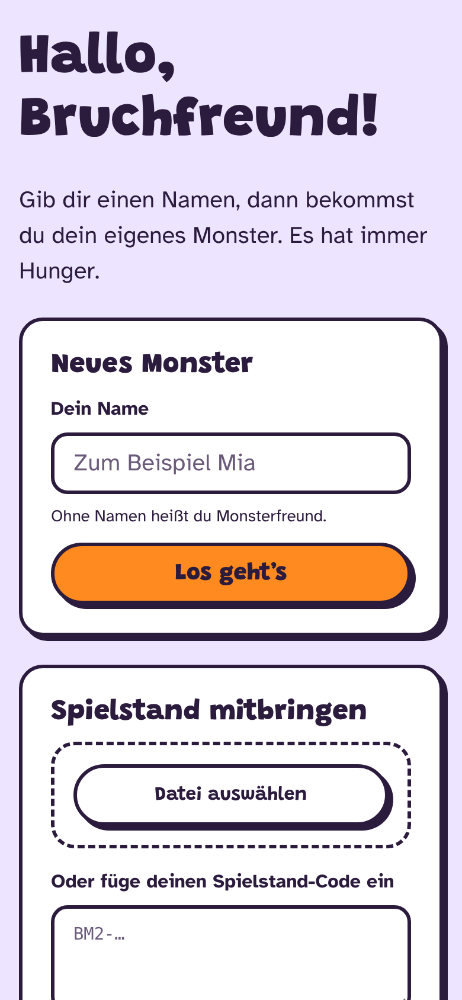 | 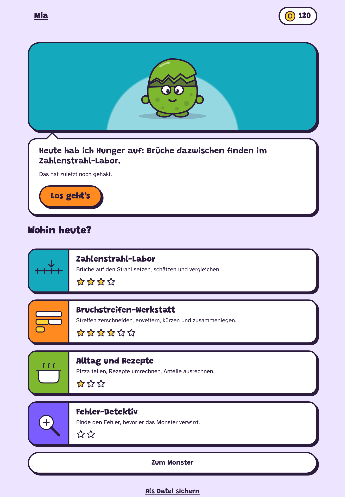 |
| 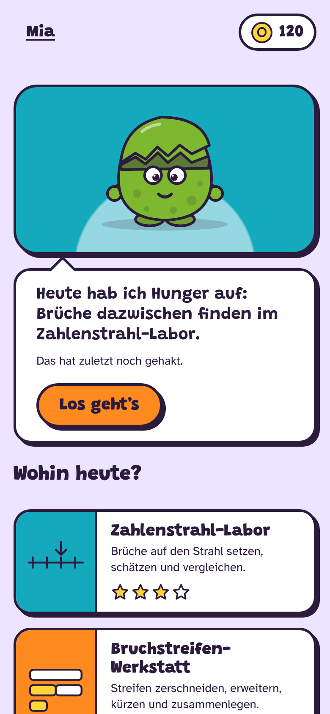 | 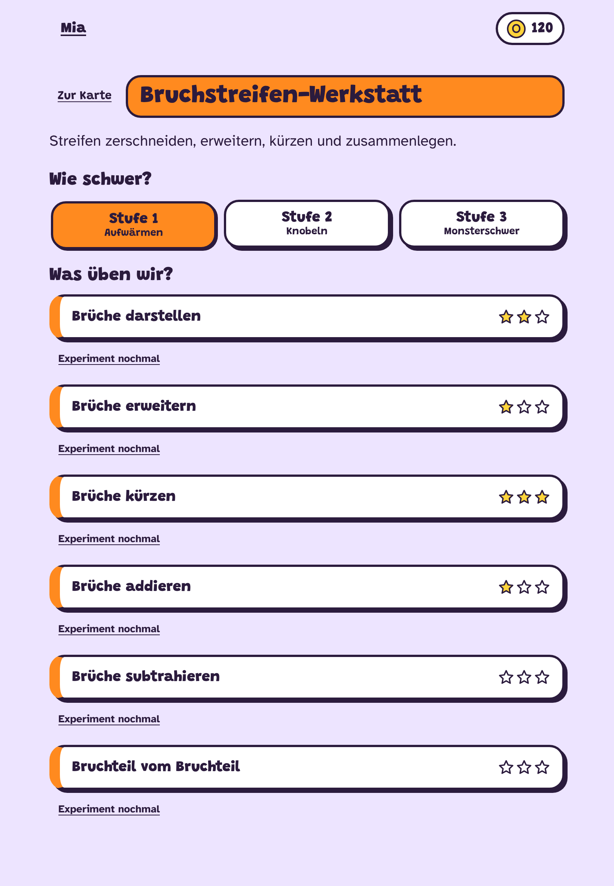 |
| 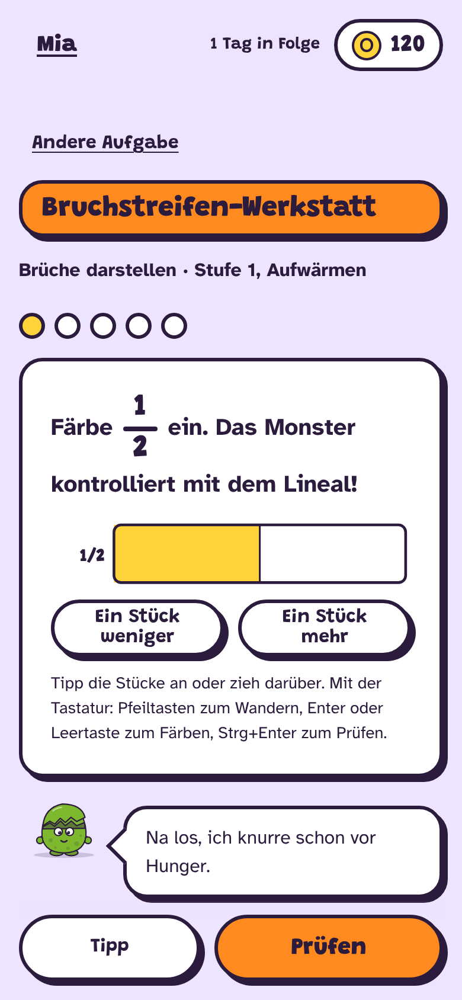 | 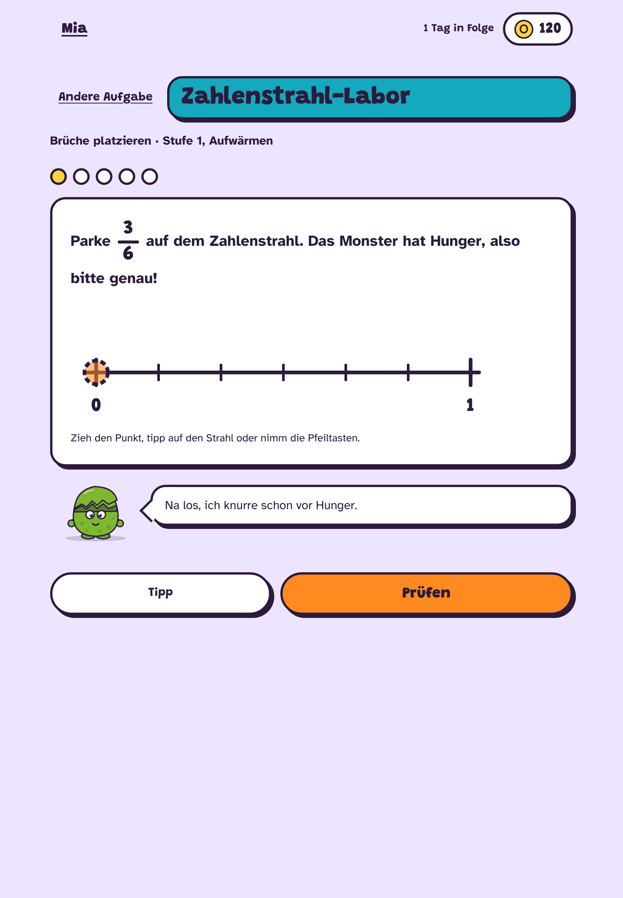 |
| 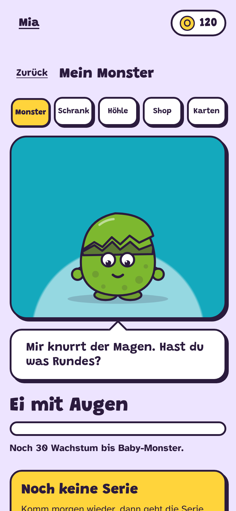 | 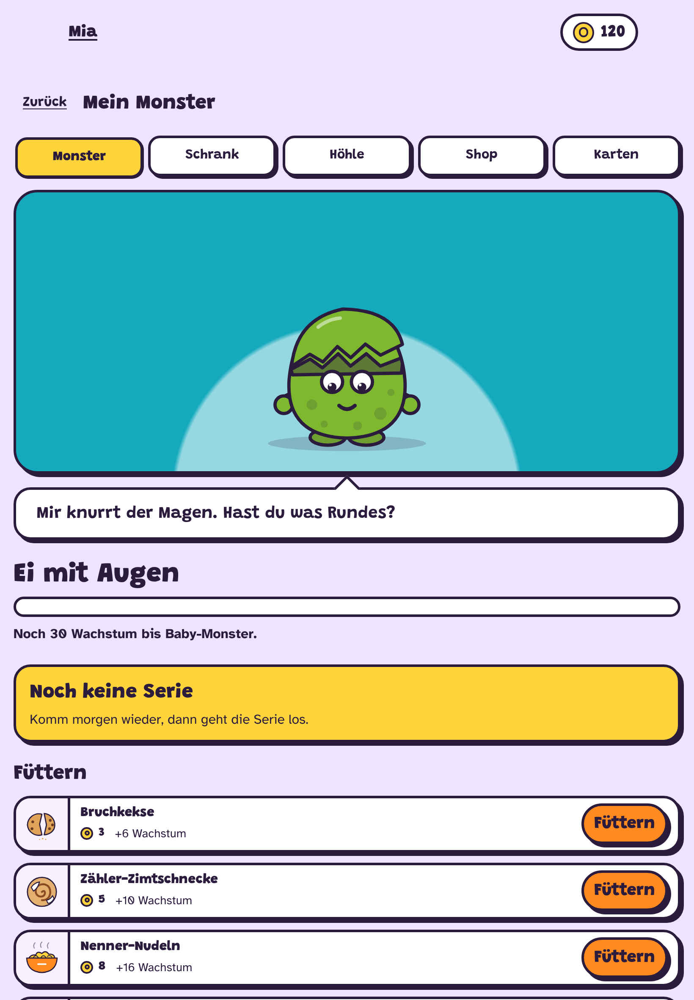 |

**Desktop**

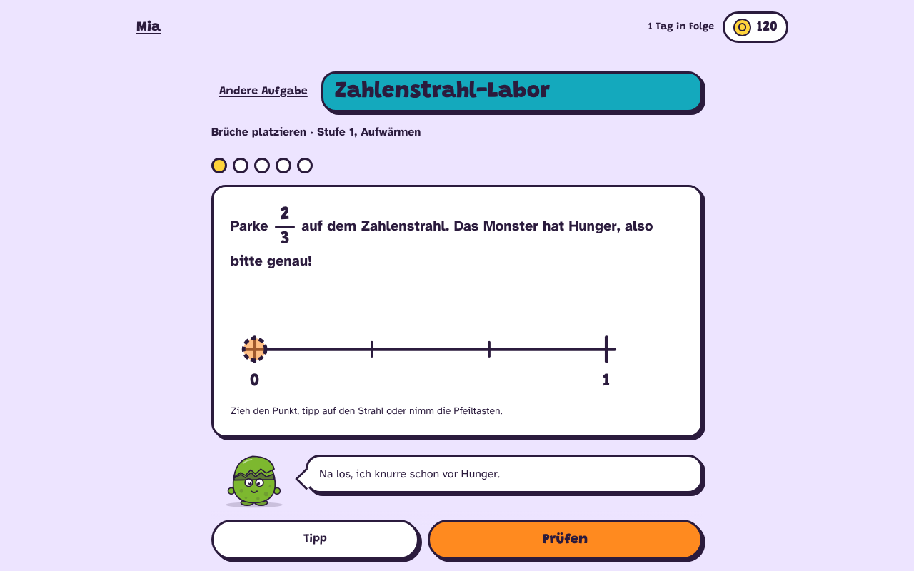
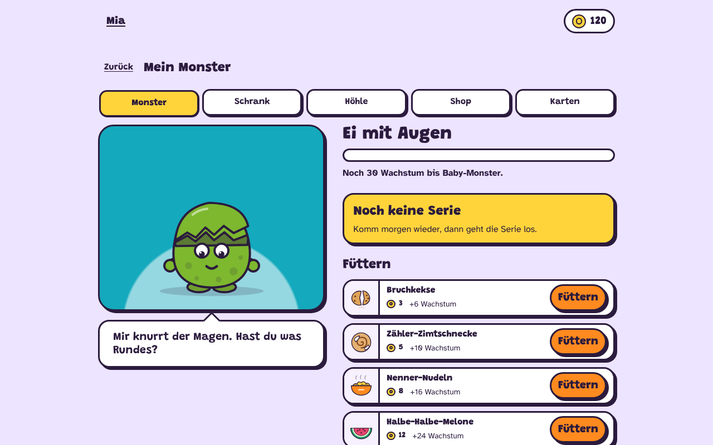

## Worum es didaktisch geht

Die App will nicht nur Rechenwege abfragen, sondern das System hinter den Brüchen sichtbar machen. Die Ideen dahinter stammen aus der Didaktik der Bruchrechnung (Grundvorstellungen nach Malle, Padberg, Wartha; Ergebnisse aus PALMA).

- **Vier Zugänge zum selben Stoff.** Kinder wählen frei, die App empfiehlt nur. Gesperrt wird nichts.
  - **Zahlenstrahl-Labor:** Brüche platzieren, schätzen, vergleichen.
  - **Bruchstreifen-Werkstatt:** darstellen, erweitern, kürzen, addieren, subtrahieren, Bruchteil vom Bruchteil.
  - **Alltag und Rezepte:** Anteile von Größen, Rezepte umrechnen, Teilen durch natürliche Zahlen.
  - **Fehler-Detektiv:** den Fehler in einer Rechnung finden und Regeln selbst entdecken.
- **Ausprobieren zuerst.** Vor jeder neuen Aufgabenart steht ein kleines Experiment, erst danach kommt die Regel. „Kenn ich schon“ überspringt es.
- **Längen statt Flächen.** Zahlenstrahl und Streifen sind die Hauptdarstellungen, weil sie die Zahlvorstellung stützen.
- **Typische Fehlvorstellungen werden erkannt.** Wer „Zähler plus Zähler, Nenner plus Nenner“ rechnet, bekommt eine passende Gegenzeichnung statt nur „falsch“.
- **Hilfe in Stufen.** Bis zu drei Tipps, dann eine Erklärzeichnung. Die Lösung zeigt die App erst nach Versuchen.
- **Raten lohnt sich nicht.** Nach einem Fehlversuch gibt es bei Auswahl-, Zahlenstrahl- und Streifenaufgaben keine Münzen mehr. Je Aufgabenart gilt ein Tageslimit. Es gibt keine Rangliste und keine Konkurrenz.

Stoff: Bruchbegriff, Darstellen, Vergleichen, Erweitern und Kürzen, Addieren und Subtrahieren, Multiplizieren und Teilen durch natürliche Zahlen (angelehnt an LehrplanPLUS Mathematik 6, Bayern).

## Benutzung

1. Die Seite oben öffnen oder `dist/bruchmonster.html` herunterladen und im Browser öffnen. Getestet ist die App mit Chrome; andere aktuelle Browser sollten funktionieren, sind aber nicht geprüft. Maus, Touch und Tastatur sind vorgesehen.
2. Namen eingeben, Monster bekommen, Welt wählen.

**Datenschutz:** Das Spiel selbst sendet nichts. Beim Aufruf über GitHub Pages sieht allerdings GitHub, wie bei jeder Webseite, die Zugriffe (siehe [Datenschutz auf schmidbauer.io](https://schmidbauer.io/datenschutz/)). Wer das vermeiden will, nimmt die heruntergeladene Datei, die auch ohne Internet läuft. Der Spielstand bleibt in beiden Fällen nur im eigenen Browser. In der App selbst stehen im Fuß der Startseite und des Hubs **Impressum** und **Datenschutz**; die Datenschutzerklärung verweist auf die [allgemeine Datenschutzerklärung von GitHub](https://docs.github.com/de/site-policy/privacy-policies/github-general-privacy-statement), weil die Seite über GitHub Pages ausgeliefert wird.

**Wichtig:** Zum Spielen die Datei herunterladen und im normalen Browser-Fenster öffnen. In Vorschau-Fenstern (etwa in Chat-Programmen oder E-Mail-Vorschauen) kann der Browser das Speichern sperren, dann ist der Spielstand beim Schließen weg.

### Spielstand sichern

Der Spielstand liegt im Speicher des Browsers. Wer den Verlauf löscht oder das Gerät wechselt, braucht eine Sicherung:

- **Als Datei sichern:** auf dem Profilbildschirm beim Profil, im Hub oder beim Monster. Es entsteht eine kleine Sicherungsdatei, die nicht lesbar ist.
- **Code kopieren:** Der Spielstand lässt sich auch als Text („Spielstand-Code“, beginnt mit `BM2-`) kopieren und zum Beispiel per Mail oder Chat an sich selbst schicken. Geht das Kopieren nicht, zeigt die App den Code zum Markieren an. Der Code ist dasselbe versiegelte Format wie die Datei.
- **Zurückholen:** auf dem Profilbildschirm unter „Spielstand mitbringen“. Die Sicherungsdatei einfach auf das Feld ziehen (oder „Datei auswählen“), oder den Code in das Textfeld einfügen und „Code laden“ drücken. Zeilenumbrüche und Leerzeichen im Code stören nicht.
- **Erinnerung:** Bei jedem Profil steht, wann zuletzt gesichert wurde. Nach etwa 20 neuen richtigen Antworten ohne Sicherung erinnert der Hub freundlich daran.
- Kann der Browser nicht speichern (Privatmodus, gesperrter Speicher), weist die App darauf hin und bleibt benutzbar.

## Grenzen

- Die App ist **noch nicht mit Kindern im Unterricht erprobt**.
- Ein Test mit echtem Touch-Gerät und eine Kontrastmessung stehen noch aus. Bei 9 bis 12 Streifenstücken sind einzelne Stücke schmaler als 44 px. Als Ausweg gibt es „Ein Stück mehr/weniger“ und das Ziehen über mehrere Stücke.
- Eine Einbindung in Moodle oder mebis (SCORM, H5P) ist denkbar, aber nicht gebaut.

## Sicherheit

**Spielstand.** Der Spielstand (Datei und Browser-Speicher) ist verschlüsselt und mit einer Prüfsumme versehen. Er ist nicht lesbar, und jede Änderung von Hand führt dazu, dass er abgelehnt wird. Ein Kind kann also nicht mal eben Münzen im Texteditor oder in den Browser-Werkzeugen eintragen. Alte, unverschlüsselte Dateien werden nicht mehr angenommen.

**Ehrliche Grenze.** Die App läuft komplett im Browser, der Schlüssel steckt deshalb im Programmtext. Wer den Quelltext liest und selbst Code schreibt, kann gültige Spielstände bauen, und wer die HTML-Datei lokal bearbeitet, kann alles ändern. Auch ein alter Spielstand lässt sich erneut einspielen, und mit den Entwicklerwerkzeugen des Browsers (Haltepunkt im Programm, Werte in der Konsole ändern) lässt sich der Spielstand umgehen, weil die App ihn danach selbst siegelt. Ebenso kann man die Uhr des Geräts verstellen, um das Tageslimit für Münzen zu umgehen; die App ignoriert nur das Zurückstellen um wenige Tage. Echte Fälschungssicherheit gäbe es nur mit einem Server, den dieses Projekt bewusst nicht hat. Das Siegel ist eine Hürde für Kinder, keine Sicherheit gegen Fachleute.

**Schadcode.**

- Eine strenge Content-Security-Policy (per `<meta>`, mit Hashes beim Bau berechnet) erlaubt genau dieses eine Skript und diese Stile. Netzverbindungen, fremde Skripte, Rahmen, Formulare und Plugins sind gesperrt.
- Trusted Types sperren in Browsern, die sie kennen, das Einfügen von HTML als Text.
- Der Code benutzt kein `innerHTML`, kein `eval` und keine Laufzeit-Abhängigkeiten. Eingaben werden immer als Text gesetzt. Ein Test sucht den Quelltext nach solchen Stellen ab.
- Importierte Spielstände werden geprüft: höchstens 200 KB, nur bekannte Feldformen, begrenzte Zahlen und Listen, bereinigte Namen.

`npm test` und `python3 scripts/security-check.py` prüfen das, das zweite Skript im echten Browser, mit Angriffsversuchen. `python3 scripts/backup-check.py` prüft Sicherung, Code und Drag-and-drop im Browser. `python3 scripts/screenshots.py` erzeugt die Bilder für diese README neu (nach `npm run build`).

**Datei prüfen.** Wer die App herunterlädt, kann nachrechnen, ob sie unverändert ist, und den Wert mit [`dist/bruchmonster.html.sha256`](dist/bruchmonster.html.sha256) vergleichen:

```
sha256sum bruchmonster.html                        # Linux
shasum -a 256 bruchmonster.html                    # macOS
certutil -hashfile bruchmonster.html SHA256        # Windows
```

**Hinweis zu GitHub Pages.** Alle Pages-Seiten unter `tjrschmidbauer.github.io` teilen sich denselben Browser-Speicher. Die Schlüssel der App beginnen deshalb alle mit `bruchmonster:`.

Sicherheitslücken bitte als Issue melden oder über [schmidbauer.io](https://schmidbauer.io).

## Entwicklung

Voraussetzung: Node 22.

```
npm install
npm test          # Tests (node:test, linkedom)
npm run build     # schreibt dist/bruchmonster.html, index.html und die Prüfsumme
```

Aufbau: ES-Module in `src/` (Rechenkern in `src/core/`, Aufgaben in `src/tasks/`, Oberfläche in `src/ui/`), esbuild bündelt Skript, Stile und Schriften in eine Datei. Die Browser-Abnahme mit Playwright und Chrome ist skriptgesteuert:

```
node scripts/build-e2e.mjs
python3 scripts/acceptance.py --md tests/e2e-smoke.md
```

Entwurf und Plan liegen in `docs/superpowers/`, die Gestaltungsidee in `docs/design-direction.md`.

## Hinweis zu KI

Dieses Projekt ist mit KI-Unterstützung entstanden. Konzept, Didaktik, Auswahl der Inhalte und Freigabe stammen von mir. Programmcode, Aufgabentexte und Erklärungen hat weitgehend **Claude** (Anthropic) geschrieben, die Bruchrechnung der Aufgabengeneratoren ist durch automatische Tests abgesichert.

KI macht Fehler. Bitte sieh dir Aufgaben, Tipps und Erklärungen vor dem Einsatz im Unterricht selbst an und melde Fehler gern als Issue.

Mehr zu mir und meinem Umgang mit KI: **[schmidbauer.io](https://schmidbauer.io)**

## Lizenz

© 2026 Tobias Schmidbauer

[Creative Commons Namensnennung – Nicht kommerziell 4.0 International (CC BY-NC 4.0)](https://creativecommons.org/licenses/by-nc/4.0/deed.de). Nutzen, Kopieren, Weitergeben und Verändern sind erlaubt, auch im Unterricht, aber nur mit Namensnennung und nicht kommerziell. Die Nennung (Name und Lizenz) steht auf der Startseite der App und muss bei Weitergabe erhalten bleiben. Den Volltext enthält die Datei [`LICENSE`](LICENSE).

Die eingebetteten Schriften **Grandstander** und **Atkinson Hyperlegible** stehen unter der SIL Open Font License 1.1 und behalten ihre eigene Lizenz.
